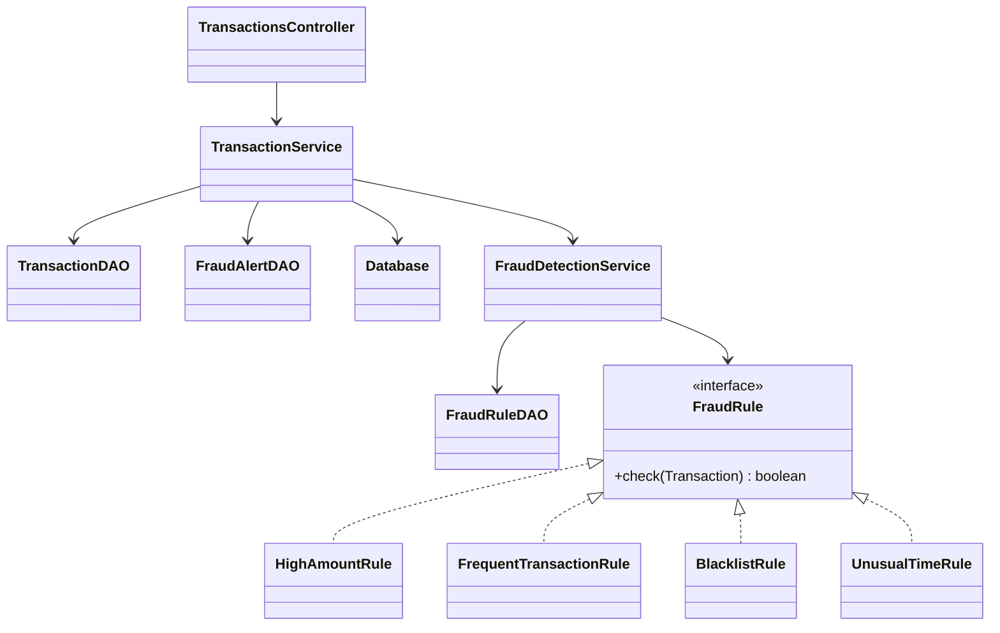
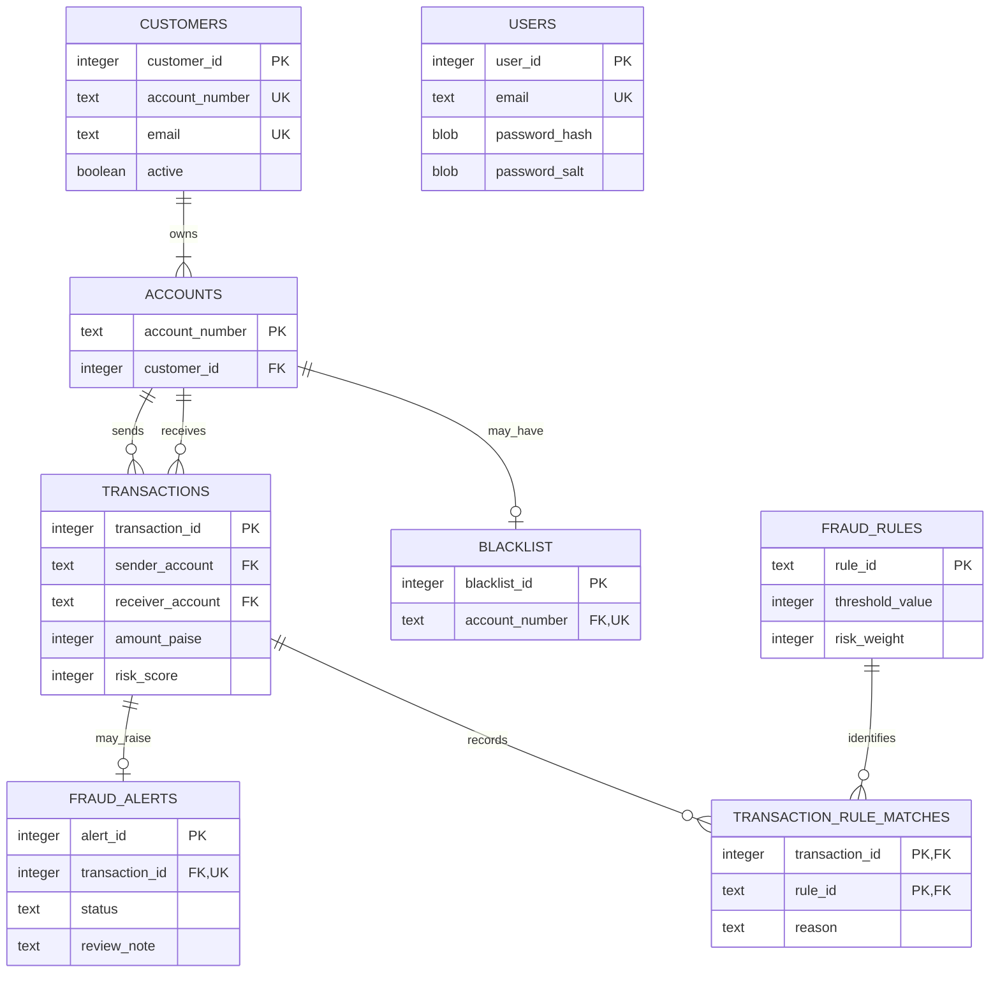
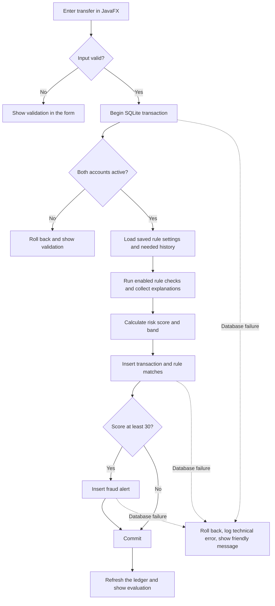

# SENTINEL viva guide

SENTINEL records synthetic financial transfers and checks each one against four fraud rules. A rule adds points when it matches. The total explains the risk level and whether the transfer needs an alert. An administrator can review alerts, change rule settings, view customer history, and export results.

## From form to database

Java is used across the desktop interface and business logic. JavaFX provides the window, forms, tables, charts, and events. FXML describes the login, application shell, and dashboard layout. CSS gives the screens a consistent visual design.

The controller reads form values and calls the service. The service validates the transfer and runs the rules. JDBC is Java’s standard API for communicating with a database. A DAO, or Data Access Object, contains the SQL for a specific type of record. Controllers work with services, and the services call the DAOs.

The service builds an `ArrayList` of rule matches. Every matching rule contributes its configured weight. The score is capped at 100. At 30 points the service marks the transfer Suspicious and creates an alert. It stores the transfer, its rule matches, and the alert in one SQLite transaction. If any part fails, the database rolls back the write. The controller displays the result returned by the service.

## Class diagram

## Database ER diagram

## Transaction flowchart

## 25 likely questions

1. **What does SENTINEL do?** It records transfers and uses four rules to flag suspicious activity for review.
2. **Why did you use Java?** It covers OOP, collections, exceptions, file handling, and JDBC in the same language used for the course.
3. **What is JavaFX?** The Java toolkit we use to build the window, pages, charts, dialogs, and forms.
4. **What is FXML?** An XML format used to describe JavaFX layouts and connect controls to a controller.
5. **What is a controller?** The Java class that handles view events, collects form input, calls services, and updates the display.
6. **What is JDBC?** Java’s standard API for opening database connections, executing SQL, and reading results.
7. **What does DAO mean?** Data Access Object. It groups the SQL for records such as customers or transactions.
8. **Why did you use SQLite?** It stores the application database in a local file and works without a separate server.
9. **How does the app connect to the database?** It opens a JDBC connection to the configured file and enables foreign-key checks.
10. **Why use a PreparedStatement?** Placeholders bind values separately from SQL, which handles special characters safely and keeps SQL readable.
11. **What is a ResultSet?** The cursor JDBC gives us to read rows returned by a query.
12. **Why use integer paise?** It stores money exactly. ₹17.62 is stored as 1762, and Java uses BigDecimal to convert it.
13. **What is an interface?** A contract for methods a class must implement. FraudRule requires a check method.
14. **What is polymorphism?** The engine can call check on a FraudRule variable and Java runs the method of the actual rule class.
15. **How does High Amount work?** It triggers above the configured rupee threshold. Exactly ₹50,000 is below the trigger condition when the threshold is ₹50,000.
16. **How does Frequent Transactions work?** It counts earlier saved transfers by the same sender in the ten-minute window, includes the submitted transfer once, and checks the count against the limit.
17. **How does the blacklist work?** A HashSet holds blocked account numbers for quick lookup. The rule checks both sender and receiver.
18. **How does Unusual Time work?** It extracts LocalTime and flags transfers from 01:00 inclusive to 05:00 exclusive, using IST.
19. **How do you calculate risk?** Add 30, 30, 50, or 20 for the respective matches and cap at 100. Scores 30 and above are Suspicious.
20. **Why can a normal transfer have a rule explanation?** The overnight rule contributes 20 points by itself. Its match is recorded even though the alert threshold is 30.
21. **How do you use ArrayList and HashMap?** ArrayList holds matches and query results. HashMap groups matches by transaction ID and indexes transactions while loading alerts.
22. **How do you handle exceptions?** InvalidTransactionException carries form validation feedback. DatabaseException wraps JDBC failures, which are recorded using java.util.logging.
23. **Why use a SQL transaction?** A transfer, its matches, and its alert form one unit. A rollback removes partial writes if a database operation fails.
24. **How does CSV export work?** A BufferedWriter writes the filtered rows in UTF-8. Fields are quoted and embedded quotes are doubled so commas and newlines stay in the field.
25. **How do you avoid duplicates at restart?** The seeder checks the demo admin in the database. Successful first-run data and the admin are committed together. Later starts reuse the same database.
